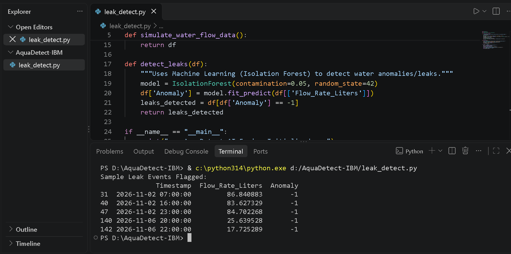

# AquaDetect: AI-Driven Micro-Leak & Water Wastage Detector

**IBM Internship Final Project Submission**
* **Target SDGs:** SDG 6 (Clean Water and Sanitation) & SDG 11 (Sustainable Cities and Communities)

## Overview
AquaDetect is an automated anomaly-detection script built in Python using Scikit-Learn's Isolation Forest algorithm. It analyzes continuous residential water flow metrics to identify hidden micro-leaks and wastage in apartment complexes.

## Tech Stack
* Python
* Pandas & NumPy
* Scikit-Learn
  
## Execution Output

## How the AI Detection Works (-1 Flag)
* **1 (Normal Flow):** Represents standard residential water usage patterns.
* **-1 (Anomaly / Leak):** Flagged by the Isolation Forest algorithm when continuous or abnormal water flow deviates from normal household habits.
